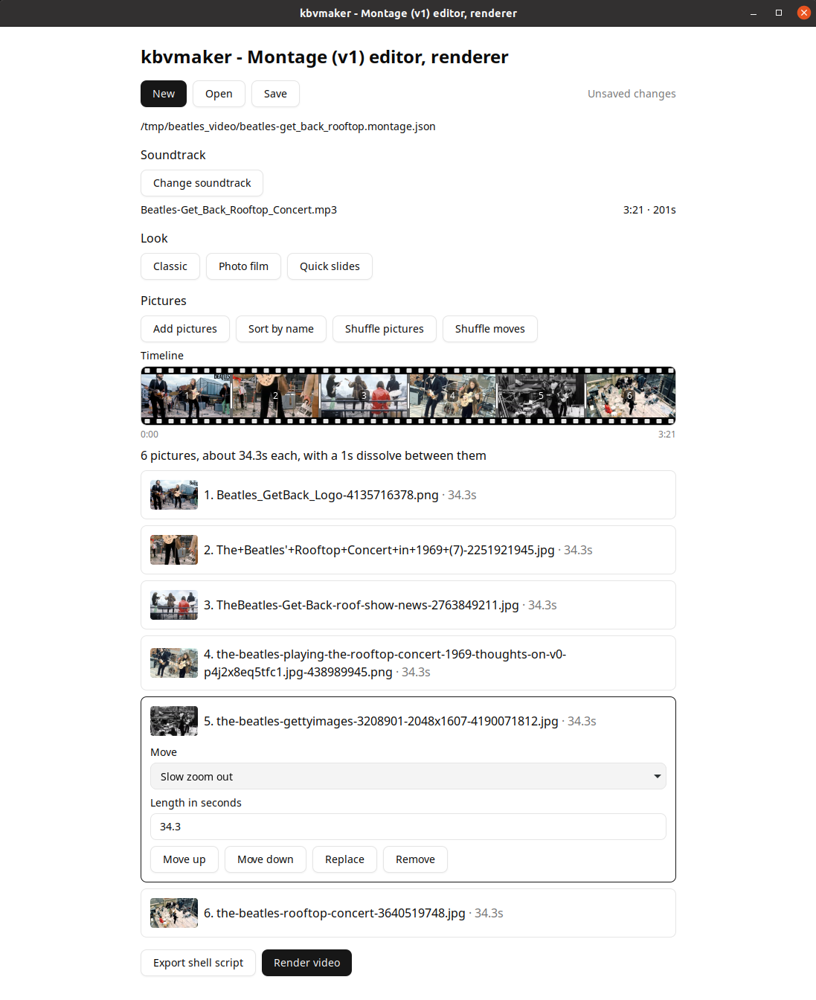

# kbvmaker - Video Maker for Still Images.

kbvmaker composes a video from still images and a soundtrack. Motion, cuts, and dissolves are described in a Montage document. The engine resolves that document into a timeline and drives ffmpeg.

The application is kbvmaker. The file format is Montage. A usual project file is `name.montage.json`.
The GUI is kbvmaker-gui. This is a front-end, GUI-based, local application for creating and rendering Montage files.

## Status

Montage 1 and the Go engine that loads it are in this tree. The command line checks a Montage, prints the resolved plan, exports the render as a bash script or as `renderPlan` JSON, and renders the video. It is built to run unattended in scripts and pipelines. It reads and renders Montage files but does not create or edit them yet.

The GUI and the local browser are two hosts of one Svelte client. Both call the Go API at `/v1`. The editor creates and saves a Montage, lists the pictures in their saved order, pins picture lengths, applies looks, shows a read-only timeline of the plan, and exports a script or renders the video. The shape is in `IDEAS.md` under Editor and Hosts. A multi-session site is later. The resolution rules stay in the `v1` packages.

`make_Greenhouse_video_v3.sh` is the first Greenhouse tape, kept as a reference. It is not the application.

## Documents

| File | Role |
| --- | --- |
| `montage-v1.md` | Normative specification of Montage 1. |
| `IDEAS.md` | Design record: why the frame model, timing, and exports look the way they do. |
| `CLI.md` | Command-line reference: commands, streams, exit codes, overrides, rendering. |
| `AGENT.md` | Notes for an agent changing this repository. |

Where `IDEAS.md` and `montage-v1.md` disagree, the specification wins.

## Install

Prebuilt downloads are not published yet. Build the command line or the GUI from source.

The command line needs [Go 1.23](https://go.dev/dl/) or newer, plus `ffmpeg` and `ffprobe` on `PATH`. `go test ./...` skips the short render when ffmpeg is absent. The GUI needs those and a few more tools. `./scripts/build` checks for them and, on Linux, uses the WebKitGTK library that is already installed.

## Build from source

### Command line

```
go build -o kbvmaker ./cmd/kbvmaker
```

### Desktop editor

Linux and macOS:

```
./scripts/build
./kbvmaker-gui
```

Windows, from PowerShell:

```
powershell -File scripts\build.ps1
.\kbvmaker-gui.exe
```

Git Bash or WSL on Windows can run `./scripts/build` instead.

The script installs frontend dependencies on a fresh checkout, builds the Svelte client, then builds the GUI. Restart the GUI after rebuilding the client. On Linux it uses WebKitGTK 4.1 when that library is installed, and WebKitGTK 4.0 otherwise. If neither is installed, it prints one package command for apt, dnf, pacman, or zypper and stops. Windows uses the WebView2 runtime that ships with current Windows 10 and Windows 11. macOS uses the system WebKit, and the script asks for the Xcode command line tools when `clang` is missing.

## GUI

kbvmaker-gui is the editor. One screen holds the project, the song, a look, the pictures, and a read-only timeline of how the film will play. The same screens run in a browser. The GUI adds native file dialogs that reopen in the last folder used for that kind of file.

The browser host types a path into the box instead of opening a dialog:

```
kbvmaker serve -static frontend/build
```

ffmpeg runs on the machine that serves the page.



### Making a film

**New** starts a Classic project in memory. **Save** asks where to write it, and the dialog suggests `piece.montage.json`. **Open** reads a Montage that already exists. The line beside the buttons shows "Unsaved changes" until Save, then "Saved". The path sits under the buttons. Save writes the file with no song and no pictures yet. Picture and song paths are stored relative to the project file, so the folder can move with its media.

**Add soundtrack** picks the audio (`mp3`, `wav`, `m4a`, `flac`, or `aac`). The file name and its length appear beside the button. **Change soundtrack** replaces it.

A **look** sets the pacing, the dissolve, and a move on every picture. Classic is selected for a new project. The project file keeps its name. The video is 1920×1080.

| Look | How time is shared | Between pictures | Behind the photo | Moves |
| --- | --- | --- | --- | --- |
| Classic | Pictures share the song | 1s dissolve | Black | Alternates slow zoom in and slow zoom out |
| Photo film | Pictures share the song | 1.5s dissolve | A blurred copy of the photo | Cycles slow zoom in, pan across, drift down, and slow zoom out |
| Quick slides | Each picture is 5 seconds | 0.5s dissolve | Black | Slow zoom in on every picture |

Quick slides gives every picture the same five seconds, so a length pinned on one picture is cleared.

**Add pictures** appends them in the order you picked (`jpg`, `jpeg`, `png`, or `webp`). That order is the film. **Sort by name**, **Move up**, and **Move down** rewrite it. A file that shows up later in a folder stays out of the film until you add it.

The timeline shows each picture as soon as you add it, as a block on a track. The block shows a thumbnail of the picture, and its number when there is room. The file name is the tooltip. The same thumbnail sits beside each name in the list. Before the song is known, the blocks are equal. After that, they take their clip lengths, a darker band marks each dissolve, and the axis runs from 0:00 to the end of the film. The selected picture is outlined. Click a block or a row to select that picture. The line under the timeline says how it will come out: how many pictures, about how long each one stays, and the dissolve between them.

Thumbnails come from `POST /v1/thumbnail` with `{path, width, height}`. Each edge is from 1 to 512 pixels. The picture is scaled to cover that box and center-cropped, and the reply is JSON: `{type, width, height, data}` where `data` is a base64 JPEG. The window and the browser both use that JSON.

The selected picture sets its own move: Slow zoom in, Pan across, Drift down, Slow zoom out, or Hold still. When the pictures share the song and there are two or more, **Length in seconds** pins that picture and the others share what remains. **Share the rest** hands that time back. One picture runs for the whole song. Quick slides keeps one length for every picture, so the length box stays closed. **Replace** and **Remove** change that picture. **Shuffle pictures** reorders the list once. **Shuffle moves** assigns each picture one of the moves once. The next time the file opens, that order and those moves are what was saved.

**Export shell script** and **Render video** both need a song and at least one picture. Each saves the Montage first, then asks where the file should go (`render.sh` or `out.mp4`). While a render runs, the controls lock and a timer counts beside the button. When it finishes, the line names the video and how long the render took. A failed ffmpeg step shows its error. An engine error is shown on the picture it belongs to.

Each dialog remembers its own folder: the project, the pictures, the song, the script, and the video.

## Command line

```
go build -o kbvmaker ./cmd/kbvmaker

kbvmaker validate      [--media] FILE    check the document (--media: also the song, photos, ffmpeg)
kbvmaker plan          FILE              resolved timeline as JSON
kbvmaker export-script FILE              the render as a bash script
kbvmaker export-plan   FILE              the render as renderPlan JSON
kbvmaker render        FILE              run ffmpeg and write the video
kbvmaker serve                           the /v1 HTTP API on 127.0.0.1:8787
kbvmaker version
kbvmaker help [COMMAND]
```

`FILE` is a Montage document, or `-` to read one from stdin (relative paths then resolve against `-dir`). Flags may come before or after it. `CLI.md` is the full reference.

Everyday use:

```sh
kbvmaker validate --media piece.montage.json          # ok: 24 pictures, 3:42
kbvmaker render piece.montage.json                    # [5/30] clip 3/24 ... wrote /films/piece/out.mp4 in 4:12
kbvmaker render -o take2.mp4 --audio take2.wav piece.montage.json
kbvmaker export-script -o render.sh piece.montage.json && ./render.sh
```

### In a pipeline

The command line keeps one contract so a script can rely on it:

- **stdout is data only:** plan JSON, the script, the `renderPlan`, the rendered video's path, or `ok`. `-o FILE` writes the result to a file instead, through a temporary file and a rename.
- **stderr carries progress and errors.** `-json` prints an error as one line, `{"slot":2,"code":"missing-media","message":"image b.jpg"}`, the same shape as `/v1`. `render -progress json` prints one JSON object per step.
- **Exit codes say what failed:**

  | Code | Meaning |
  | --- | --- |
  | 0 | Success |
  | 1 | Unexpected failure |
  | 2 | Usage mistake |
  | 3 | Document breaks a rule |
  | 4 | Missing media or tool |
  | 5 | ffmpeg step failed |
  | 130 | Interrupted |

- **Flags override the file for one run.** `-audio`, `-join`, `-hold`, `-zoom-span`, `-blur`, `-seed`, `-schedule`, and `-o` (the video, on `render`) win over the document. Nothing is written back.
- **Renders are safe to retry.** The video is written under a hidden partial name and renamed at the end, so a failed or interrupted run never leaves half a video at the output path. SIGINT or SIGTERM stops ffmpeg. `-work DIR` moves the intermediates, and `-clean` removes them after success.

```sh
#!/bin/sh
# Render every project in a folder. Skip broken ones, stop if ffmpeg breaks.
for f in projects/*.montage.json; do
  if ! kbvmaker validate --media --json "$f" 2>>errors.jsonl; then
    echo "skip $f" >&2
    continue
  fi
  video=$(kbvmaker render --clean --progress json "$f" 2>>progress.jsonl)
  status=$?
  case $status in
    0)   echo "$video" >> rendered.txt ;;
    5)   echo "ffmpeg failed on $f" >&2; exit 5 ;;
    130) exit 130 ;;
    *)   echo "failed $f ($status)" >&2 ;;
  esac
done
```

```sh
# A generated document on stdin, rendered against a media folder.
generate-montage | kbvmaker render --dir /media/greenhouse -o /out/greenhouse.mp4 -
```

`serve` exposes the same engine over HTTP for programs that prefer it. `-addr` changes the address, and `-static frontend/build` also serves the client. It stops cleanly on SIGINT or SIGTERM.

## Layout

The module path is `neal/kbvmaker`. [Montage 1](montage-v1.md) is the package tree `v1`.

```
Document → Plan → []Command → bash | renderPlan JSON | exec
```

| Package | Responsibility |
| --- | --- |
| `v1` | Facade: load, resolve, compile, export, run. |
| `web/v1` | HTTP API for Montage 1. |
| `cmd/kbvmaker` | Command line. Calls the `v1` facade only. |
| `cmd/desktop` | Wails GUI: native dialogs and the `/v1` bridge. |
| `frontend/` | Svelte client shared by the browser and the GUI. |
| `v1/version` | The integer shared by the API, `montage`, and `renderPlan`. |
| `v1/doc` | JSON types, defaults, and structural checks. |
| `v1/model` | The resolved plan. |
| `v1/media` | Probe interface. ffprobe is one implementation. |
| `v1/clock` | Time spellings resolved to seconds. |
| `v1/frame` | Fill zoom, fitted rectangle, clamped window. |
| `v1/schedule` | Pools, natural sort, shuffle, and loop. |
| `v1/timing` | `fit-audio`, `fixed-clip`, `explicit`, `markers`. |
| `v1/motion` | Built-in modes and segment expansion. |
| `v1/check` | Rule checks on a resolved slot. |
| `v1/plan` | Orchestrator. |
| `v1/compile` | Plan to ffmpeg argv, including batched `xfade`. |
| `v1/export` | Bash and `renderPlan` JSON. |
| `v1/run` | Exec the argv list with progress events, an atomic final write, and cancellation. Stop on the first failure. |
| `v1/rule` | Slot index, stable code, message. |

`v1.Version`, the document field `montage`, and the export field `renderPlan` are the same number. Today that number is 1. A later Montage is a new package, `v2`, which accepts `montage: 2`. Version 1 keeps loading version-1 documents.

## Tests

```
go test ./...
pnpm --dir frontend test
```

Unit tests cover decode, clocks, fill zoom, scheduling, and the 20-second two-clip timing case. One test resolves a document through a fake probe and checks that both exports carry the compiler's argv. One test writes a PNG and a WAV, renders a short hold, and checks the output size and duration with ffprobe.

The command-line tests run `cli` with a fake probe and a stand-in ffmpeg script. They cover help, every usage error, exit codes, JSON errors, stdin and `-dir`, overrides, `-o` files, progress, `-clean`, a failed step, an interrupt, `serve`, and a plan that matches `/v1`. One more test renders a real video when ffmpeg is installed. The desktop tests open the real GTK dialogs when a display is available, and send an editor save through the GUI's `/v1` bridge. The frontend tests (Vitest with happy-dom) cover the document operations, the editor screen, and the GUI host.
